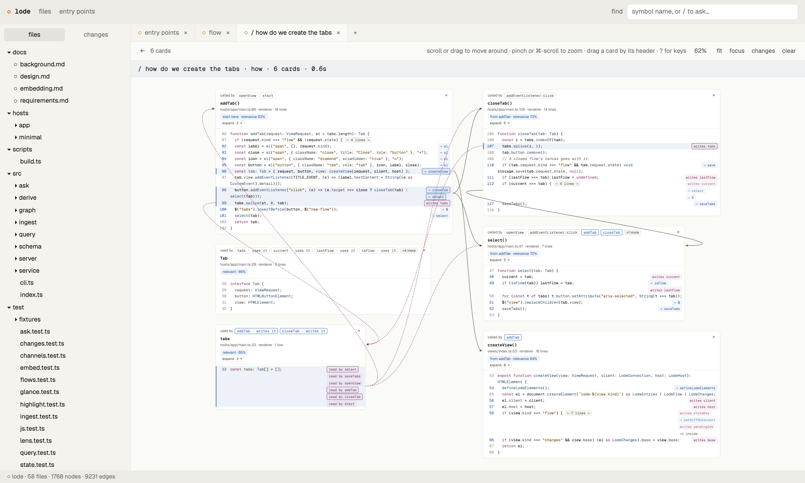
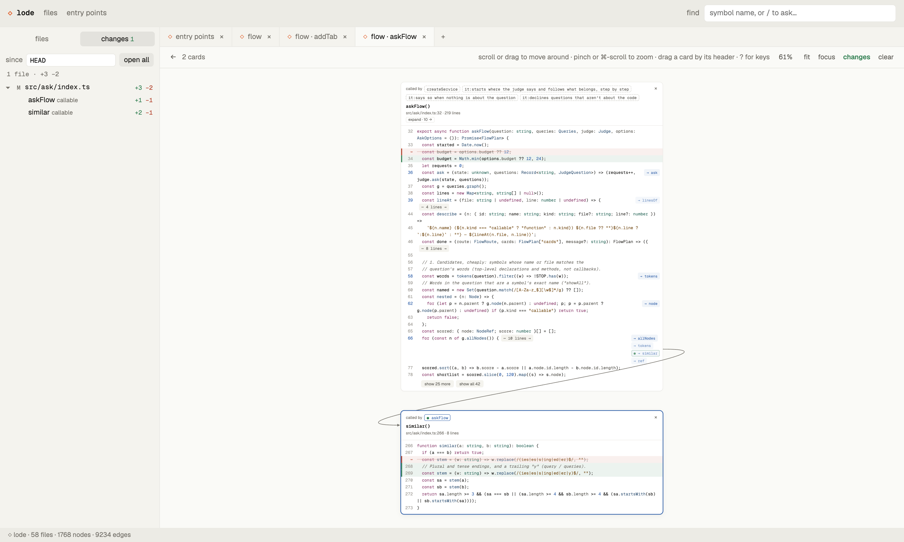

# ◇ lode

**Read a codebase as a flow of real code.** lode builds a live graph of how
your code fits together and lets you read it as cards of actual code on a
canvas, connected by arrows: what calls what, what flows where, what reads
and writes which state, across processes. Ask it a question with **/** and
it lays out the answer as a flow. Talk to an LLM about what's on the
canvas, and it explains the code and works the canvas for you. Point it at
your git changes and it shows what changed and what might break. Edit right
in the cards.

**Languages:** TypeScript and JavaScript (React, Next.js, React Native,
Vue, Svelte, Angular, Express, Nest…), Python (Django, FastAPI, Flask,
Celery, pytest…) and Ruby (Rails, Sinatra, RSpec…). Point it at a folder;
it works out what's there.

It's a library first: a code graph and query core, embeddable views, and a
small host contract, so any editor or app can show it. It also ships a
standalone app that runs on any folder.



## Features

### Languages
Each language comes with its frameworks' conventions, detected from the
project (its package.json, Gemfile, pyproject.toml…): routes, views,
templates, jobs and commands become entry points, and the links frameworks
make by name (a route to its handler, a template to its view, a link to
its page) become arrows. Mixed repos get every language they have.

| | parsed with | frameworks |
| --- | --- | --- |
| **TypeScript / JavaScript** | the TypeScript compiler: exact, type-checked links | React, Next.js, Remix / React Router, React Native (React Navigation, Expo Router), Vue, Nuxt, Svelte, SvelteKit, Angular, Express, Nest, Electron |
| **Python** | tree-sitter (no Python install needed) | Django, FastAPI, Flask, Starlette, Celery, pytest, click / typer / argparse |
| **Ruby** | tree-sitter (no Ruby install needed) | Rails (incl. ERB and jbuilder views), Sinatra, RSpec, FactoryBot, Thor, rake |

<details>
<summary>What each language and framework resolves</summary>

- **TypeScript and JavaScript** through the TypeScript compiler: exact,
  type-checked links, plus Electron IPC and events across processes.
  Monorepos work (each file resolves imports with its nearest tsconfig's
  path aliases; workspace packages by name; Nx-style solution configs).
- **TS/JS frameworks**, detected per app from its package.json: React
  (JSX renders are links), Next.js (app and pages routers, API routes,
  server actions), Remix / React Router (file and object routes, loaders),
  React Native (React Navigation screens, Expo Router), Vue and Nuxt
  (single-file components, templates, named routes), Svelte and SvelteKit,
  Angular (templates' bindings, child components by selector, router
  links, lifecycle hooks), Express and Nest (routes as entry points).
  Navigation (`<Link href>`, `router.push`, `navigation.navigate("Profile")`,
  `routerLink`, `:to="{ name }"`, path helpers like
  `paths.post.getHref(id)`) links to the page or screen it opens; Express
  routes carry their mounted prefixes (`/api/articles/:slug`).
- **Python** through tree-sitter: names resolved through imports
  (relative, absolute, re-exported by packages), classes and their bases,
  and what variables hold, from type annotations, assignments and return
  types (`user = repo.get(1)` with `get` annotated `-> User`).
- **Python web frameworks**, detected automatically: FastAPI, Flask and
  Starlette routes (with router prefixes) and `Depends`; Django URLs (with
  `include()`), class-based views, the ORM, management commands and
  signals, custom managers and querysets, the hooks Django calls (views'
  `get_queryset`, models' `save`…), templates (views to templates,
  ``, ``, `` to views); Celery tasks and
  `.delay()`. Also pytest fixtures (a test's
  parameter is the fixture), CLI commands (click, typer, argparse,
  console scripts) as entry points, `@property` reads, functions passed as
  callbacks, and abstract methods to their implementations.
- **Ruby** through tree-sitter (no Ruby install needed): calls resolved the
  way Ruby looks them up (self, constants, `new`, mixins, superclasses,
  `module_function`, `extend self`), and typed through whole chains: what a
  variable was assigned, what a method returns (its last expression,
  `@user ||= User.find(…)`), block parameters (`users.each do |user|`),
  `attr_reader`, `self.class`, `send(:name)`; name-matched only when
  there's exactly one candidate, and marked as inferred.
- **Rails**, detected automatically: routes to controller actions (entry
  points by verb and path), callbacks, associations as typed methods
  (`user.posts.published.first` reaches `Post`'s scope and methods),
  `delegate`, scopes, concerns, finders and relations, mailers, jobs, rake
  tasks and test fixtures. **Views** (ERB and jbuilder): an action links
  to its view and a view to its partials; a view's code runs as its
  controller's, so `@post.title` and helpers resolve. **Sinatra** routes and filters; **RSpec** `let`
  and `subject` (typed, with FactoryBot's `create(:user)`) and
  `described_class`; **Thor** commands.

</details>

Go and Java are next, on the same tree-sitter base.

### The flow canvas
- **Cards of real code**, one per function, class, type or file, with
  syntax colouring. Long bodies fold into `⋯ N lines`, which open as their
  own card or in place (comments and imports). Cards page in 25 lines at
  a time ("show 25 more", "show all", "collapse").
- **Chips** on each line show what it leads to (calls, IPC channels, state
  it writes); click one to open it beside the card with an arrow from that
  line. Every card shows **who calls it** too.
- **Expand** opens everything a card leads to, one level, in one click.
- **Trees, tabs, layout:** open as many trees as you like, drag cards,
  scroll to pan, pinch to zoom, fit or focus, ⌘-click to select several
  and move, fit, focus or close them together. Undo everything. Each flow
  tab keeps its canvas across reloads.
- **Any file:** README, docs, JSON, CSS and other project files open as
  text cards too (Markdown headings fold into sections).

### Ask for a flow (/)
Type **/** in the top box (or press **/** on a flow) and ask in plain words:
`/how do we create the tabs`, `/what happens when a gem is pushed`,
`/what calls showAll`, `/where are api keys checked`,
`/what most likely breaks from these changes`. lode answers with a flow in
a new tab, usually in under half a second: the card to start reading at,
then each step it leads to, in reading order, each with a note on why it's
there.

How it works: it isn't an LLM writing an answer, and every card is a real
piece of your code.
1. **Find candidates.** A text search over every symbol's name, path,
   comment and code (forgiving typos: `acount balence` still finds
   `Account#balance`), plus any symbol the question names exactly.
2. **Judge them.** [TypeSafe's Jev](https://docs.typesafe.ai), a fast
   model that makes typed judgments, decides in one request what kind of
   question it is (how something works, where something is, what calls
   something, what changed, what might break) and which candidates are
   about it, and picks where to start.
3. **Follow the graph.** From the start, lode walks what it calls (or what
   calls it, for "what calls…"), and Jev judges whether each next step
   belongs. Change questions start from your git diff instead and score
   how likely each dependent is to break.

Two or three model calls, a fraction of a cent. Questions worded in your
own terms work when they share words with the code (or a typo of them);
pure synonyms the code never uses ("ledger" for code that says journal)
are the known limit. `eval/` measures it against real repos.

### Explain with an LLM, and let it work the canvas
lode explains a canvas with an LLM; the UI is the host's. The standalone
app has an **explain** panel (press **i**, or "explain" in the header): a
conversation with an LLM about what's on the canvas. Ask it
to explain the whole flow or the cards you've selected, what could break,
or anything ("why does closeTab call select?"). The answer streams in,
grounded in the exact code on the canvas (the cards, how they connect, the
diff if changes are shown), and every code name in it is a link to its
card.

It can also **do things on the canvas** when you ask ("also show where the
tabs get saved", "expand that", "build the flow for checkout"):
- search and read the graph, beyond what's on the canvas;
- add cards, build a whole flow for a question (with Jev), expand a card,
  open or close a fold (and read what it revealed), close cards;
- select, focus or fit the view, and turn git changes on or off.

Each action shows as a chip in the answer (click it to see those cards),
one ⌘Z undoes everything it did in a message, it opens new tabs only when
you ask for one, and it never edits code. Conversations are kept per tab.

A host builds its own explain UI (a side panel, an overlay, notes in
cards) from the flow's `scope()`, `apply()` and `highlight()` and the
service's `explain`; the app's panel (`hosts/app/explain.ts`) is the
example.

Explaining works with Claude (Anthropic API) and anything OpenAI-compatible
(OpenAI, OpenRouter, Groq, Together, Ollama, LM Studio, vLLM), all at once:
every provider you have a key for appears in the app's model picker,
grouped by provider, and you pick per question. It sits behind a small `ChatModel`
interface any model can implement, and a host can offer its own list of
models or limit which are allowed.

### Git changes



- **Changes sidebar:** every changed file, dropping down into the
  declarations that changed as a hierarchy (a class over its methods),
  with +/− counts, against `HEAD` or any ref. It updates live as files
  change, so an agent's edits show up as they land.
- **Diffs on cards:** added lines in green, removed lines struck through
  where they were, folds that hide changes marked. Cards open at their
  changes.
- **Open all** lays every changed symbol out as a flow (callers left of
  what they call); **open N changes** opens a card's changed folds at
  once; chips that lead to a change are marked, so you can follow them.

### Edit in place
Press **Enter** on a card to edit its code; **⌘S** saves. You edit exactly
what the card shows; hidden lines are never touched. Saves are checked
against the file (a conflicting change is refused, not overwritten), the
graph re-indexes, and undo goes back past a save.

### Context for LLMs
lode knows which code matters, so it can hand a model exactly that instead
of whole files: full code at the centre (unrelated folds collapsed),
signatures and the connecting line one hop out, names further out, and
the connections spelled out, sized to a token budget.

- **`lode mcp`** serves it to any agent over MCP (Claude Code, Cursor,
  Clance…): `lode_read` (a symbol and its surroundings), `lode_context` (a
  question or symbols), `lode_impact` (what your changes touch),
  `lode_search`, `lode_changes`, `lode_entries`. `skills/lode/SKILL.md`
  teaches agents when to use which.
- **Copy context** (the app's flow toolbar; `flow.context()` for any
  host) copies a flow's cards (or the selected ones) as Markdown for a
  chat, with the diff if changes are shown.
- Deterministic by default (same commit and request, same context);
  `rank: "judge"` lets Jev choose what's relevant.

```sh
npm run build
claude mcp add lode -- node /path/to/lode/dist/lib/src/cli.js mcp /path/to/project
```

### Keyboard
A line cursor in the selected card: **↑↓** lines, **→** follow a chip or
fold (**Tab** picks which), **←** back along the arrow, **[ ]** cards in
reading order, **n / ⇧N** next and previous change, **e** expand, **o / c**
open and fold, **Space** focus, **f** fit, **/** ask, **?** every key.

### Entry points
Where to start reading an unfamiliar codebase: what the outside world calls
into. Routes by verb and path (Rails, Django, FastAPI, Flask, Express,
Nest, Next.js pages and API routes, Sinatra), pages and screens, server
actions, jobs (Celery, ActiveJob, Sidekiq), tasks and commands (rake,
manage.py, click, Thor, console scripts), IPC handlers and messages
between processes, events, the hooks a framework calls, and exports
nothing in the project calls; grouped by runtime (web, jobs, tasks; main,
renderer…), with a line on how the runtimes talk
(`renderer → preload: 230 · preload → main: 139`).

## Quick start

```sh
git clone https://github.com/damiensmith1/lode.git && cd lode
npm install
npm run lode -- open path/to/any/project     # the app, in your browser
```

A project is any folder (or a `tsconfig.json` / `jsconfig.json`). lode
picks the languages from what's there: TS/JS from a tsconfig or .ts/.js
files (JavaScript always included: ESM, CommonJS, JSDoc types), Python from
a pyproject.toml, setup.py, requirements.txt or .py files, Ruby from a
Gemfile, Rakefile or .rb files, and each one's frameworks from its
dependencies. The graph is cached in
`~/.cache/lode/` (`--cache <dir>` to change it); nothing is written into
the project unless you save an edit.

For **/** questions and the explain panel, copy `.env.example` to `.env`
(every setting is explained there) and add keys. In short, a `.env` in lode's
folder (it's git-ignored; lode reads only its own settings from it, and
only from its own folder, never a project's):

```sh
TYPESAFE_API_KEY=your-key                 # / questions (Jev)

# explain: every provider with a key is offered, picked per question
ANTHROPIC_API_KEY=your-key                # Claude (Sonnet, Haiku, Opus)
OPENAI_API_KEY=your-key                   # OpenAI, or a compatible server via OPENAI_BASE_URL
LODE_OPENAI_MODELS=model-id=Label,…
OPENROUTER_API_KEY=your-key               # OpenRouter
LODE_OPENROUTER_MODELS=vendor/model=Label,…
```

Other commands:

```sh
npm run lode -- serve <project> [--port n] [--origin url]   # just the server, for another host
npm run lode -- index <project> [--json out.json]            # build the graph, print a summary
npm run lode -- node <project> 'src/main.ts#run'             # one node, its edges each way
node dist/lib/src/cli.js mcp <project>                       # MCP server on stdio, for agents (after npm run build)
```

## How it fits together

```
 any folder ──▶ language plugin ──▶ graph (core) ──▶ queries ──▶ service ──┬─▶ WebSocket server ─▶ views in any web page
                TS/JS, Python,      nodes, edges,    block,      the       └─▶ any message channel ─▶ views in a webview, Electron, …
                Ruby + frameworks
                                    channels,        entries,    methods,
                                    regions          search,     no transport        view: <lode-flow> (the canvas), lodeApi
                                                     changes,                        host: your editor or app (tabs, lists,
                                                     ask (Jev)                         toolbars, explain UI, storage, theme)
```

- **Core** (`src/schema`, `src/ingest`, `src/derive`, `src/graph`): a
  deterministic, incremental graph of a project: containment, calls,
  references, and data flows in three tiers (within a function, through
  shared state, across process boundaries such as Electron IPC). Language
  support is a plugin: TypeScript in `src/ingest/ts`; Ruby and Rails in
  `plugins/` on a shared tree-sitter base (`plugins/treesitter`), as are
  Python and its web frameworks.
- **Queries** (`src/query`): what the views need, all deterministic: code
  blocks with their links and callers, entry points, search, file lists,
  git changes mapped to symbols.
- **Ask** (`src/ask`): a flow for a question, built from graph candidates
  that a `Judge` (Jev by default) scores.
- **Context** (`src/context`, `src/mcp`): slices of the graph formatted
  for language models, and an MCP server that serves them.
- **Explain** (`src/explain`): a conversation about the canvas with a
  `ChatModel` (Claude by default) that can search and read the graph and
  work the canvas (add cards, build flows, expand, fold, close, focus).
- **Service and server** (`src/service`, `src/server`): the queries as
  methods with no transport, a file watcher, and an optional localhost
  WebSocket server.
- **Views** (`views/`): framework-free web components with shadow DOM,
  that know nothing about the page around them.
- **Hosts** (`hosts/`): the standalone app, and a whole host in one HTML
  file.

## Embed it anywhere

lode is built to be plugged into an editor (VS Code, JetBrains), an
Electron app, or any web page. A host decides how views reach the core,
where their state lives, how they look, which keys do what, and what
"open this file" means. Everything below is in
[`docs/embedding.md`](docs/embedding.md).

**Packages:** `lode` (core, queries, service, ask, context), `lode/server`, `lode/mcp`,
`lode/views`, a self-contained bundle in
`dist/views` for pages without a bundler, and the `lode` command
(`npm run build` makes them).

**Run the core** in Node, on any folder, and keep it current:

```ts
import { GraphStore, pluginFor, createService } from "lode";

const service = createService(GraphStore.open(await pluginFor(folder), folder)); // TS/JS, Python, Ruby: whatever's there
service.watch(); // re-index as files change; views update
```

**Connect the views** over whatever the host has: a localhost WebSocket
(`startServer`, `LodeClient`), or any message channel with no server or
port, like a VS Code webview's `postMessage`:

```ts
// extension / main process
serveMessages(service, { send: (m) => panel.webview.postMessage(m), listen: (h) => panel.webview.onDidReceiveMessage(h).dispose });
// webview
const connection = new MessageConnection({ send: (m) => vscode.postMessage(m), listen: (h) => /* window "message" events */ });
```

**Mount views** with a host:

```ts
const flow = createView({ kind: "flow", id: "src/main.ts#run", state: "tab-1" }, connection, {
  openView: (request) => { /* open or reuse a tab */ },
  openSource: (file, line) => editor.open(file, line), // optional: else files open as cards
  highlight: (lines) => editor.decorate(lines),         // optional: mark what the card covers
  syntax: (text, file) => editor.tokenize(text, file),  // optional: your syntax colours (HTML per line)
  storage: workspaceStorage,                            // where each tab keeps its canvas
});
```

What a host can plug in or take over:

| | |
| --- | --- |
| **Transport** | `LodeConnection`: WebSocket client, `MessageConnection`, or your own `{ call, onChanged }` |
| **State** | `LodeStorage` per view key: the project's cache (default), `localStorage`, memory, or yours (VS Code `workspaceState`, a database) |
| **Look** | every colour and font is a `--lode-*` token (light and dark themes included, syntax colours too); `::part()` on every piece; `host.css` inside every view |
| **Markup** | `host.render` hooks add your own HTML to card headers, footers, line ends and chip labels, with `data-action="host:…"` buttons |
| **Interaction** | events for every action (cancelable, so you can take any over: open chips in your editor), selection, open, close, edits, saves |
| **Keys** | every key is a command; remap, disable, or drive `flow.run(command)` from your own keybindings |
| **Editing** | read-only, per card, or yours: `host.saveEdits` lets the editor apply saves with its own undo |
| **Your own UI** | `lodeApi(connection)`: files, `buildFileTree`, search, entries, changes, symbol at cursor, ask |
| **Asking** | `flow.ask(question)`, `flow.loadPlan(plan)`, or your own model behind the `Judge` interface |
| **Explaining** | the service's `explain` (streams `explain` events on the connection) with the flow's `scope()` / `apply()` / `highlight()` for your own UI; `explain()` in Node; your own model behind `ChatModel` |
| **LLM context** | `contextFor(request)` in Node, `lode/mcp` (`serveMcp`) for agents, `flow.context()` to send a canvas to your own agent |
| **Languages** | a `LanguagePlugin` reads a project into nodes, edges, channels and fold regions; the core does the rest |

`hosts/minimal/index.html` is a complete host in one page, from the
prebuilt bundles.

## Security

The server listens on localhost only and every connection needs the
session's random token, an allowed Origin and a localhost Host header, so
other web pages can't read your code. Reads and writes are limited to the
project's own files (resolved for real, inside the root). Model keys stay
on the server. `.env` files are read for lode's own key only.

## Development

```sh
npm test            # unit and integration tests, on fixtures
npm run typecheck
npm run build       # dist/lib, dist/app, dist/views
npm run build:web   # just the app
```

`eval/` measures **/** answers against questions with known answers:
`npx tsx eval/run.ts eval/example.json` (needs `TYPESAFE_API_KEY`); put
your own suites in `eval/local/` (git-ignored). `docs/` holds the
background, requirements and design notes, kept current with the code.

## License

[MIT](LICENSE) © Damien Smith
